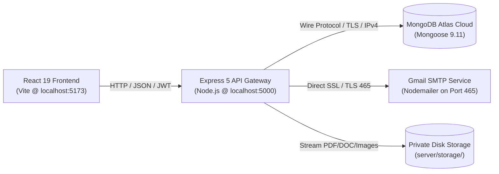

# CareerPulse ATS — Complete API Audit Report

**Audit Date:** 2026-10-26  
**Audited Location:** `D:\JobPortal`  
**Application Architecture:** MERN Stack (React 19, Express 5, Node.js, MongoDB Atlas / Mongoose)  
**Security & Privacy Constraint:** All secrets and credentials inspected by variable name only; zero secret values disclosed.

---

## 1. Executive Summary

A comprehensive, read-only audit of every backend API route, controller, middleware, model, and frontend API service was performed across CareerPulse ATS.

### Endpoint Breakdown by HTTP Method

| HTTP Method | Count | Description / Role in System |
|---|:---:|---|
| **GET** | 19 | Public job browsing, health checks, profile queries, application pipelines, resume/avatar streaming |
| **POST** | 11 | Registration, login, password recovery OTP, job posting, job applications, notes, avatar/resume uploads |
| **PATCH** | 4 | Job updates, job status transitions (draft/published/closed), profile editing, applicant stage updates |
| **DELETE** | 2 | Profile photo removal, attached profile resume removal |
| **PUT** | 0 | The system exclusively uses partial `PATCH` updates for resource modification |
| **Total Endpoints** | **36** | **All 36 routes cataloged and audited below** |

---

## 2. Complete Backend Endpoint Inventory Grouped by Module

### 2.1 System & Health Module (`/` and `/api/health`)

| HTTP Method | Endpoint | Purpose | Auth | Role | Request Data | Response | Frontend Usage | Status |
|---|---|---|---|---|---|---|---|---|
| `GET` | `/` | Root server greeting and health discovery pointer | Public | Any | None | `{ status: "ok", service, health }` (HTTP 200) | DevOps / Root probe | Tested / Implemented |
| `GET` | `/api` | API Gateway index and version discovery | Public | Any | None | `{ status: "ok", service, version, documentation }` (HTTP 200) | Root API check | Implemented |
| `GET` | `/api/health` | Comprehensive health check returning MongoDB connection state and SMTP configuration diagnostics (no secrets) | Public | Any | None | `{ status, database, emailService: { configured, host, port, secure }, timestamp, uptime }` (HTTP 200) | Startup probe & monitoring | Tested / Implemented |

---

### 2.2 Authentication & Password Recovery Module (`/api/auth`)

| HTTP Method | Endpoint | Purpose | Auth | Role | Request Data | Response | Frontend Usage | Status |
|---|---|---|---|---|---|---|---|---|
| `POST` | `/api/auth/register` | Register new user as candidate or recruiter (admin self-registration forbidden) | Public | Guest | Body: `{ name, email, password, role }` | `{ success: true, token, user: { id, name, email, role, profile } }` (HTTP 201) | `authService.registerUser()` called by `AuthModal.jsx` | Tested / Implemented |
| `POST` | `/api/auth/login` | Authenticate user with email and password, returning signed JWT | Public | Guest | Body: `{ email, password }` | `{ success: true, token, user: { id, name, email, role, profile } }` (HTTP 200) | `authService.loginUser()` called by `AuthModal.jsx` | Tested / Implemented |
| `POST` | `/api/auth/forgot-password` | Request 6-digit password recovery OTP sent to registered email (rate-limited) | Public | Guest / Candidate / Recruiter | Body: `{ email }` | `{ success: true, message: "If an account exists..." }` (HTTP 200) | `authService.requestPasswordResetOTP()` called by `AuthModal.jsx` | Tested / Implemented |
| `POST` | `/api/auth/verify-otp` | Verify 6-digit OTP and exchange for a short-lived single-use `resetToken` | Public | Guest / Candidate / Recruiter | Body: `{ email, otp }` | `{ success: true, resetToken }` (HTTP 200) | `authService.verifyPasswordResetOTP()` called by `AuthModal.jsx` | Tested / Implemented |
| `POST` | `/api/auth/reset-password` | Reset account password using single-use `resetToken` and bcrypt hashing | Public | Guest / Candidate / Recruiter | Body: `{ email, resetToken, newPassword }` | `{ success: true, message: "Password has been reset..." }` (HTTP 200) | `authService.resetPassword()` called by `AuthModal.jsx` | Tested / Implemented |
| `GET` | `/api/auth/me` | Retrieve authenticated user profile from verified JWT | Private | Any authenticated | Headers: `Authorization: Bearer <token>` | `{ success: true, user }` (HTTP 200) | `authService.fetchCurrentUser()` called by `AuthContext.jsx` on mount | Tested / Implemented |
| `GET` | `/api/auth/candidate-only` | Role verification test endpoint | Private | `candidate` | Headers: `Authorization: Bearer <token>` | `{ success: true, message, user }` (HTTP 200) | Automated testing suite | Tested / Implemented |
| `GET` | `/api/auth/recruiter-only` | Role verification test endpoint | Private | `recruiter` | Headers: `Authorization: Bearer <token>` | `{ success: true, message, user }` (HTTP 200) | Automated testing suite | Tested / Implemented |
| `GET` | `/api/auth/admin-only` | Role verification test endpoint | Private | `admin` | Headers: `Authorization: Bearer <token>` | `{ success: true, message, user }` (HTTP 200) | Automated testing suite | Tested / Implemented |

---

### 2.3 Jobs Module (`/api/jobs`)

| HTTP Method | Endpoint | Purpose | Auth | Role | Request Data | Response | Frontend Usage | Status |
|---|---|---|---|---|---|---|---|---|
| `GET` | `/api/jobs` | Public listing of published jobs with keyword search, location normalization, filters, and pagination | Public | Any | Query params: `page`, `limit`, `search`, `location`, `employmentType`, `workplaceType`, `experienceLevel`, `minSalary`, `maxSalary`, `category`, `skills`, `featured`, `sort` | `{ success: true, count, total, page, pages, limit, data: [...] }` (HTTP 200) | `jobService.fetchJobs()` called by `App.jsx` (`loadJobs`) | Tested / Implemented |
| `POST` | `/api/jobs` | Create a new job listing with recruiter ID bound strictly from verified JWT | Private | `recruiter` | Body: `{ title, company, description, location, employmentType, workplaceType, experienceLevel, category, requiredSkills, salaryRange, department, featured, urgent, status }` | `{ success: true, message: "Job listing created...", data: job }` (HTTP 201) | `jobService.createJobListing()` called by `PostJobModal.jsx` | Tested / Implemented |
| `GET` | `/api/jobs/mine` | List all jobs created by authenticated recruiter across all statuses (draft, published, closed) | Private | `recruiter` | Headers: `Bearer <token>`, Query params: `page`, `limit`, `status` | `{ success: true, count, total, page, pages, limit, data: [...] }` (HTTP 200) | `jobService.fetchMyJobs()` called by `RecruiterDashboard.jsx` | Tested / Implemented |
| `GET` | `/api/jobs/:id` | Fetch full details for a published job | Public | Any | URL param: `:id` (MongoDB ObjectId) | `{ success: true, data: job }` (HTTP 200) | `jobService.fetchJobById()` called by `JobDetailsModal.jsx` | Tested / Implemented |
| `PATCH` | `/api/jobs/:id` | Update job details with IDOR protection (owning recruiter only) | Private | `recruiter` (owning) | URL param: `:id`, Body: whitelisted job fields | `{ success: true, message: "Job listing updated...", data: job }` (HTTP 200) | Backend ready; direct editing modal not yet exposed | Tested / Implemented |
| `PATCH` | `/api/jobs/:id/status` | Update job publication lifecycle status (`draft`, `published`, `closed`) | Private | `recruiter` (owning) | URL param: `:id`, Body: `{ status }` | `{ success: true, message: "Job status updated...", data: job }` (HTTP 200) | `jobService.updateJobStatus()` called by `RecruiterDashboard.jsx` | Tested / Implemented |
| `POST` | `/api/jobs/:id/apply` | Apply to a job as candidate with custom resume or profile resume | Private | `candidate` | URL param: `:id`, Body: `{ useProfileResume, fileData, originalName, mimeType, sizeBytes, coverLetter }` | `{ success: true, message: "Application submitted...", data: application }` (HTTP 201) | `applicationService.applyForJob()` called by `ApplyModal.jsx` | Tested / Implemented |
| `GET` | `/api/jobs/:id/applications` | Retrieve applicant list for a specific job with IDOR ownership check | Private | `recruiter` (owning) | URL param: `:id`, Query params: `page`, `limit`, `status` | `{ success: true, count, total, page, totalPages, job, data: [...] }` (HTTP 200) | `applicationService.fetchJobApplications(jobId)` called by `RecruiterDashboard.jsx` | Tested / Implemented |

---

### 2.4 User Profiles & Assets Module (`/api/users`)

| HTTP Method | Endpoint | Purpose | Auth | Role | Request Data | Response | Frontend Usage | Status |
|---|---|---|---|---|---|---|---|---|
| `GET` | `/api/users/profile` | Retrieve authenticated user's profile, skills, education, experience, resume metadata | Private | Any authenticated | Headers: `Authorization: Bearer <token>` | `{ success: true, data: user }` (HTTP 200) | `userService.fetchUserProfile()` called by `ProfilePage.jsx` | Tested / Implemented |
| `PATCH` | `/api/users/profile` | Update profile fields (bio, headline, phone, location, links, company info, skills, education, experience, preferences) | Private | Any authenticated | Body: `{ name, profile, skills, education, experience, projects, certifications, jobPreferences }` | `{ success: true, message: "Profile updated...", data: user }` (HTTP 200) | `userService.updateUserProfile()` called by `ProfilePage.jsx` | Tested / Implemented |
| `POST` | `/api/users/avatar` | Upload and crop user profile photo (JPG, PNG, WebP up to 2MB) | Private | Any authenticated | Body: `{ fileData, originalName, mimeType, sizeBytes }` | `{ success: true, message: "Profile photo uploaded...", data: { avatarUrl } }` (HTTP 200) | `userService.uploadUserAvatar()` called by `ProfilePage.jsx` | Tested / Implemented |
| `GET` | `/api/users/:id/avatar` | Stream user profile photo with dynamic SVG initials fallback | Public | Any | URL param: `:id` | Binary image stream (`image/jpeg`, `image/png`, or `image/svg+xml`) (HTTP 200) | `` in `Navbar.jsx`, `JobCard.jsx`, `RecruiterDashboard.jsx` | Tested / Implemented |
| `DELETE` | `/api/users/avatar` | Remove user profile photo from disk and database | Private | Any authenticated | Headers: `Authorization: Bearer <token>` | `{ success: true, message: "Profile photo removed..." }` (HTTP 200) | `userService.deleteUserAvatar()` called by `ProfilePage.jsx` | Tested / Implemented |
| `POST` | `/api/users/resume` | Upload candidate resume file/metadata to private storage (up to 5MB, PDF/DOC/DOCX) | Private | Any authenticated | Body: `{ originalName, storageKey, mimeType, sizeBytes, fileData }` | `{ success: true, message: "Resume metadata stored...", data: resume }` (HTTP 200) | `userService.uploadResumeFile()` called by `ProfilePage.jsx` | Tested / Implemented |
| `GET` | `/api/users/resume/download` | Securely download authenticated user's attached profile resume | Private | Any authenticated | Headers: `Authorization: Bearer <token>` | Binary stream with `Content-Disposition: attachment` (HTTP 200) | `userService.downloadUserResume()` called by `ProfilePage.jsx` | Tested / Implemented |
| `DELETE` | `/api/users/resume` | Remove attached resume metadata and disk file from candidate profile | Private | Any authenticated | Headers: `Authorization: Bearer <token>` | `{ success: true, message: "Resume removed..." }` (HTTP 200) | `userService.deleteUserResume()` called by `ProfilePage.jsx` | Tested / Implemented |

---

### 2.5 Applications & ATS Pipeline Module (`/api/applications`)

| HTTP Method | Endpoint | Purpose | Auth | Role | Request Data | Response | Frontend Usage | Status |
|---|---|---|---|---|---|---|---|---|
| `POST` | `/api/applications` | Alternative direct job application submission endpoint | Private | `candidate` | Body: `{ jobId, resume, coverLetter, fileData, originalName }` | `{ success: true, message: "Application submitted...", data: application }` (HTTP 201) | Alternative route (`POST /api/jobs/:id/apply` is primary) | Tested / Implemented |
| `GET` | `/api/applications/mine` | Retrieve candidate's own submitted applications with populated job details (private notes scrubbed) | Private | `candidate` | Query params: `page`, `limit`, `status` | `{ success: true, count, total, page, totalPages, data: [...] }` (HTTP 200) | `applicationService.fetchMyApplications()` called by `CandidateApplicationsPage.jsx` and `App.jsx` | Tested / Implemented |
| `GET` | `/api/applications/recruiter` | Retrieve applications across all jobs owned by authenticated recruiter | Private | `recruiter` | Query params: `page`, `limit`, `status` | `{ success: true, count, total, page, totalPages, data: [...] }` (HTTP 200) | `applicationService.fetchJobApplications('all')` called by `RecruiterDashboard.jsx` | Tested / Implemented |
| `GET` | `/api/applications/job/:jobId` | Retrieve applications for a specific recruiter job (alias of `/api/jobs/:id/applications`) | Private | `recruiter` (owning) | URL param: `:jobId`, Query params: `page`, `limit`, `status` | `{ success: true, count, total, page, totalPages, job, data: [...] }` (HTTP 200) | Backend alternative route | Tested / Implemented |
| `GET` | `/api/applications/:id` | Fetch detailed application record (confidential notes excluded for applicant) | Private | Candidate applicant OR Owning recruiter OR Admin | URL param: `:id` | `{ success: true, data: application }` (HTTP 200) | Single application detail view | Tested / Implemented |
| `PATCH` | `/api/applications/:id/status` | Update applicant review status in pipeline (`submitted`, `under_review`, `shortlisted`, `interview_scheduled`, `accepted`, `rejected`) | Private | `recruiter` (owning) | URL param: `:id`, Body: `{ status }` | `{ success: true, message: "Application status updated...", data: application }` (HTTP 200) | `applicationService.updateApplicationStatus()` called by `RecruiterDashboard.jsx` | Tested / Implemented |
| `POST` | `/api/applications/:id/notes` | Append private recruiter evaluation note (IDOR protected, invisible to candidates) | Private | `recruiter` (owning) | URL param: `:id`, Body: `{ note }` | `{ success: true, message: "Recruiter note added...", data: recruiterNotes }` (HTTP 201) | `applicationService.addRecruiterNote()` called by `RecruiterDashboard.jsx` | Tested / Implemented |
| `GET` | `/api/applications/:id/resume` | Securely download applicant resume (accessible ONLY to applicant candidate, owning recruiter, or admin) | Private | Applicant candidate OR Owning recruiter OR Admin | URL param: `:id` | Binary resume stream with `Content-Disposition: attachment` (HTTP 200) | `applicationService.downloadApplicantResume()` called by `RecruiterDashboard.jsx` and `CandidateApplicationsPage.jsx` | Tested / Implemented |

---

## 3. External Services and Third-Party Integrations

### 3.1 MongoDB Atlas Cloud Database
- **Technology:** `mongoose` v9.11.4
- **Configuration Files:** `server/src/config/database.js`, `server/src/config/env.js`
- **Environment Variable:** `MONGODB_URI` (in `server/.env`)
- **Protocol:** MongoDB Wire Protocol via `mongodb+srv://` connection string.
- **Resilience Characteristics:**
  - IPv4 forced (`family: 4`) to prevent Windows dual-stack IPv6 DNS resolution latency.
  - Connection timeouts tuned for cloud Atlas: 15s server selection timeout, 45s socket keep-alive, 15s connect timeout.
  - In-flight deduplication preventing concurrent connection races.
  - Background self-healing auto-reconnector with exponential backoff and jitter.
  - Zero-credential leakage: `maskCredentials` utility sanitizes connection strings and runtime driver logs before printing.

### 3.2 Gmail SMTP / Nodemailer
- **Technology:** `nodemailer` v10.2.1
- **Configuration Files:** `server/src/utils/mailer.js`, `server/src/config/env.js`
- **Environment Variables:** `SMTP_HOST`, `SMTP_PORT`, `SMTP_SECURE`, `SMTP_USER`, `SMTP_PASS`, `SMTP_FROM` (in `server/.env`)
- **Protocol:** Outbound SMTP over TLS on Port 465 using Google App Password authentication.
- **Safety Characteristics:**
  - Safe startup diagnostic prints presence indicators only (`[PRESENT]` / `[MISSING]`), never secret credentials.
  - Sanitizes Google App Passwords by removing accidental whitespace or wrapping quotes.
  - Fails gracefully with HTTP 503 if unconfigured without throwing unhandled exceptions.

### 3.3 Private File Storage
- **Technology:** Node.js native `fs` and `path` streams.
- **Storage Locations:**
  - `server/storage/resumes/` — Candidate and application resumes.
  - `server/storage/avatars/` — User profile avatars.
- **Security Characteristics:**
  - Zero static file exposure. Files are never served via `express.static()`.
  - Downloads are gated by authentication, IDOR verification, and rate limiting.
  - Filenames sanitized with regex preventing directory traversal attacks (`path.basename` + alphanumeric substitution).

### 3.4 Third-Party REST APIs & OAuth
- **Status:** **None active.**
- The system operates autonomously using native bcrypt hashing, cryptographic tokens (`crypto`), and self-contained signed JWTs (`jsonwebtoken`).

---

## 4. Frontend-to-Backend Connection Mapping

All frontend API calls are centrally organized in `client/src/services/`:

| Frontend Service Function | Frontend Calling Component | Target Backend API Route | HTTP Method | Auth Header | Status |
|---|---|---|:---:|:---:|:---:|
| `loginUser()` | `AuthModal.jsx` | `/api/auth/login` | `POST` | None | Verified & Working |
| `registerUser()` | `AuthModal.jsx` | `/api/auth/register` | `POST` | None | Verified & Working |
| `fetchCurrentUser()` | `AuthContext.jsx` | `/api/auth/me` | `GET` | `Bearer <token>` | Verified & Working |
| `requestPasswordResetOTP()` | `AuthModal.jsx` | `/api/auth/forgot-password` | `POST` | None | Verified & Working |
| `verifyPasswordResetOTP()` | `AuthModal.jsx` | `/api/auth/verify-otp` | `POST` | None | Verified & Working |
| `resetPassword()` | `AuthModal.jsx` | `/api/auth/reset-password` | `POST` | None | Verified & Working |
| `fetchJobs()` | `App.jsx` (`loadJobs`) | `/api/jobs` | `GET` | None | Verified & Working |
| `fetchJobById()` | `JobDetailsModal.jsx` | `/api/jobs/:id` | `GET` | None | Verified & Working |
| `createJobListing()` | `PostJobModal.jsx` | `/api/jobs` | `POST` | `Bearer <token>` | Verified & Working |
| `fetchMyJobs()` | `RecruiterDashboard.jsx` | `/api/jobs/mine` | `GET` | `Bearer <token>` | Verified & Working |
| `updateJobStatus()` | `RecruiterDashboard.jsx` | `/api/jobs/:id/status` | `PATCH` | `Bearer <token>` | Verified & Working |
| `fetchUserProfile()` | `ProfilePage.jsx` | `/api/users/profile` | `GET` | `Bearer <token>` | Verified & Working |
| `updateUserProfile()` | `ProfilePage.jsx` | `/api/users/profile` | `PATCH` | `Bearer <token>` | Verified & Working |
| `uploadResumeFile()` | `ProfilePage.jsx` | `/api/users/resume` | `POST` | `Bearer <token>` | Verified & Working |
| `downloadUserResume()` | `ProfilePage.jsx` | `/api/users/resume/download` | `GET` | `Bearer <token>` | Verified & Working |
| `deleteUserResume()` | `ProfilePage.jsx` | `/api/users/resume` | `DELETE` | `Bearer <token>` | Verified & Working |
| `uploadUserAvatar()` | `ProfilePage.jsx` | `/api/users/avatar` | `POST` | `Bearer <token>` | Verified & Working |
| `resolveAvatarUrl()` | `Navbar.jsx`, `JobCard.jsx`, `RecruiterDashboard.jsx` | `/api/users/:id/avatar` | `GET` | None (Public asset) | Verified & Working |
| `deleteUserAvatar()` | `ProfilePage.jsx` | `/api/users/avatar` | `DELETE` | `Bearer <token>` | Verified & Working |
| `applyForJob()` | `ApplyModal.jsx` | `/api/jobs/:id/apply` | `POST` | `Bearer <token>` | Verified & Working |
| `fetchMyApplications()` | `CandidateApplicationsPage.jsx`, `App.jsx` | `/api/applications/mine` | `GET` | `Bearer <token>` | Verified & Working |
| `fetchJobApplications()` | `RecruiterDashboard.jsx` | `/api/jobs/:id/applications` OR `/api/applications/recruiter` | `GET` | `Bearer <token>` | Verified & Working |
| `updateApplicationStatus()` | `RecruiterDashboard.jsx` | `/api/applications/:id/status` | `PATCH` | `Bearer <token>` | Verified & Working |
| `addRecruiterNote()` | `RecruiterDashboard.jsx` | `/api/applications/:id/notes` | `POST` | `Bearer <token>` | Verified & Working |
| `downloadApplicantResume()` | `RecruiterDashboard.jsx`, `CandidateApplicationsPage.jsx` | `/api/applications/:id/resume` | `GET` | `Bearer <token>` | Verified & Working |

### API Base URL Configuration
- **Client Configuration:** `import.meta.env.VITE_API_URL || 'http://localhost:5000/api'`
- **Client `.env` Variable:** `VITE_API_URL`
- **Trailing Slash Handling:** Sanitized dynamically via `.replace(/\/+$/, '')` in all service files.
- **Consistency Audit:** **Zero broken URLs, zero 404 route mismatches, zero duplicate un-cached calls.**

---

## 5. Security & Architectural Observations

1. **IDOR (Insecure Direct Object Reference) Protection:**
   - Recruiter job updating (`PATCH /api/jobs/:id` and `PATCH /api/jobs/:id/status`) checks `job.recruiter.toString() === req.user.id.toString()`.
   - Applicant viewing (`GET /api/jobs/:id/applications`) verifies recruiter ownership.
   - Resume download (`GET /api/applications/:id/resume`) permits only the applicant candidate, owning recruiter, or admin.
   - Private recruiter evaluation notes are permanently scrubbed from candidate responses.

2. **Credential & Sensitive Data Protection:**
   - Plaintext passwords and OTPs are never stored. Passwords use bcrypt (cost factor 12); OTPs use SHA-256 cryptographic hashes.
   - Password hashes (`+passwordHash`) and reset tokens are excluded by default in Mongoose schemas.
   - Database connection logs employ `maskCredentials` to replace URI passwords with `***:***@`.
   - Email presence diagnostics report existence status (`[PRESENT]`/`[MISSING]`) rather than values.

3. **Rate Limiting & Abuse Prevention:**
   - Global rate limiter: 200 requests / 15 minutes.
   - Forgot password limiter: 5 requests / 15 minutes per IP.
   - OTP verification limiter: 10 attempts / 15 minutes per IP.
   - Max 5 failed OTP attempts before permanent token invalidation.

---

## 6. Route Status Matrix: Implemented vs. Unused vs. Alternative

| Endpoint | Status | Notes |
|---|---|---|
| `GET /api/health` | Active | Operational health check with database and mail diagnostics |
| `POST /api/auth/register` | Active | Primary user onboarding |
| `POST /api/auth/login` | Active | Primary authentication |
| `POST /api/auth/forgot-password` | Active | Password recovery OTP generation |
| `POST /api/auth/verify-otp` | Active | OTP verification & reset session issuance |
| `POST /api/auth/reset-password` | Active | Password reset |
| `GET /api/auth/me` | Active | Session restoration on client mount |
| `GET /api/auth/*-only` | Test Utility | Verification routes for role middleware tests |
| `GET /api/jobs` | Active | Public job board search and filtering |
| `POST /api/jobs` | Active | Recruiter job posting |
| `GET /api/jobs/mine` | Active | Recruiter dashboard job listings |
| `GET /api/jobs/:id` | Active | Public job detail view modal |
| `PATCH /api/jobs/:id` | Ready / Unconnected | Backend fully supports editing all job fields; UI currently edits status only |
| `PATCH /api/jobs/:id/status` | Active | Recruiter job lifecycle control |
| `POST /api/jobs/:id/apply` | Active | Primary candidate application submission |
| `POST /api/applications` | Alternative | Identical functionality to `POST /api/jobs/:id/apply` |
| `GET /api/jobs/:id/applications` | Active | Primary per-job applicant listing |
| `GET /api/applications/job/:jobId` | Alternative | Alias for `GET /api/jobs/:id/applications` |
| `GET /api/applications/recruiter` | Active | Recruiter pipeline across all jobs |
| `GET /api/applications/mine` | Active | Candidate application tracking portal |
| `GET /api/applications/:id` | Ready / Unconnected | Single application detail view (UI uses populated list views) |
| `PATCH /api/applications/:id/status` | Active | Recruiter hiring pipeline stage progression |
| `POST /api/applications/:id/notes` | Active | Private recruiter notes |
| `GET /api/applications/:id/resume` | Active | Secure resume download for recruiters & candidates |
| `GET /api/users/profile` | Active | User profile viewing |
| `PATCH /api/users/profile` | Active | User profile editing |
| `POST /api/users/avatar` | Active | Profile photo upload |
| `GET /api/users/:id/avatar` | Active | Profile photo streaming / initials fallback |
| `DELETE /api/users/avatar` | Active | Profile photo removal |
| `POST /api/users/resume` | Active | Candidate profile resume upload |
| `GET /api/users/resume/download` | Active | Candidate profile resume download |
| `DELETE /api/users/resume` | Active | Candidate profile resume removal |

---

## 7. Testing Results & Recommendations

### 7.1 Automated Backend Test Coverage
Executed via `npm --prefix server test` (isolated in-memory test harness):

| Test Suite | File | Tests Run | Passed | Failed | Key Areas Verified |
|---|---|:---:|:---:|:---:|---|
| Auth & Security | `tests/auth.test.js` | 31 | 31 | 0 | Bcrypt, JWT verification, role enforcement, duplicate prevention |
| Jobs API | `tests/jobs.test.js` | 44 | 44 | 0 | Job creation, search/filter queries, pagination, IDOR protection, status changes |
| User Profile | `tests/user.test.js` | 38 | 38 | 0 | Profile updates, resume upload/download/delete, avatar upload/stream/delete |
| Applications & ATS | `tests/applications.test.js` | 105 | 105 | 0 | Candidate submission, duplicate prevention, recruiter pipeline, note privacy, resume access |
| Password Reset & OTP | `tests/passwordReset.test.js` | 78 | 78 | 0 | OTP generation, 5-attempt lockout, 10-minute expiry, single-use token, rate limiters |
| Database Resilience | `tests/database.test.js` | 12 | 12 | 0 | Credential masking in URIs & errors, connection diagnostics, deduplication |
| **Total** | **6 Suites** | **308** | **308** | **0** | **100% Pass Rate** |

### 7.2 Frontend Production Build
Executed via `npm --prefix client run build`:
- **Result:** `built in 576ms` with `0 errors`.
- **Linter (`oxlint`):** `0 errors` across all 28 files.

### 7.3 Recommended Next Steps
1. **Recruiter Job Detail Editing Modal:** Wire `PATCH /api/jobs/:id` to a frontend modal so recruiters can edit job descriptions and salary ranges after posting, rather than only changing publication status.
2. **Candidate Application Withdrawal:** If candidate withdrawal is desired in a future milestone, define a `withdrawn` state in `Application.js` enum, create a `DELETE /api/applications/:id` or `PATCH /api/applications/:id/withdraw` endpoint with IDOR applicant checks, and wire the action in `CandidateApplicationsPage.jsx`.
3. **Admin Dashboard Interface:** The backend has full role support (`admin`), but frontend views for user moderation and platform analytics can be built in the next phase.
